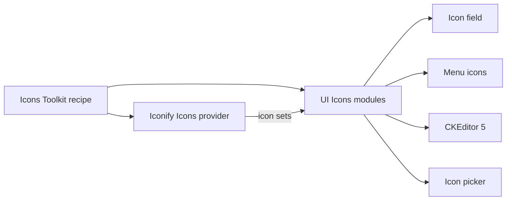

# Icons Toolkit

Icons Toolkit is a Drupal recipe. It installs and configures the UI Icons ecosystem with
Iconify Icons as the icon provider. Iconify Icons gives access to more than 200,000 icons
from more than 150 open-source icon packs.

The recipe is for sites that want icon pickers in fields, menus, and CKEditor 5 without
assembling the modules by hand.

## What the recipe provides

- The UI Icons modules: field, menu, CKEditor 5, picker, library browser, and text format
  support.
- The Iconify Icons provider, with the `mdi` (Material Design Icons) collection enabled.
- Configuration imported on apply, so the provider is ready once the recipe runs.

## How the pieces fit together

## Pages

- [Installation](installation.md): Composer requirements and how to apply the recipe.
- [Configuration](configuration.md): the imported Iconify settings and where to change them.
- [Usage](usage/index.md): what each UI Icons module adds to the site.
